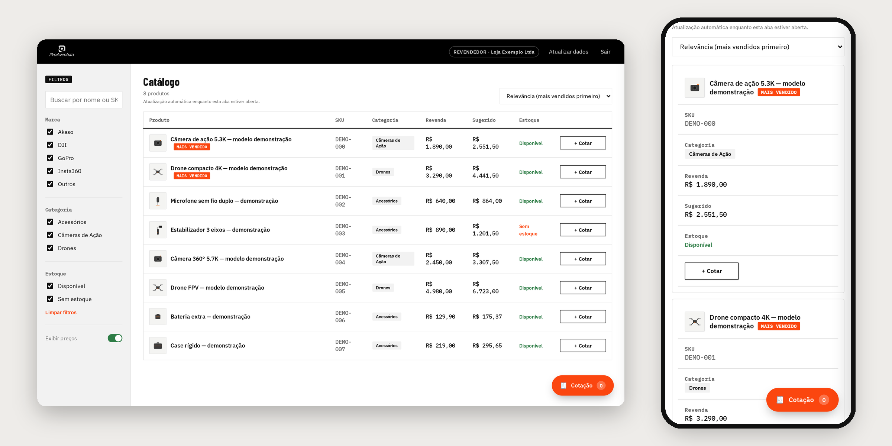

# Danilo Portilho

Estudante de **Engenharia da Computação no UNISAL** (conclusão prevista para dez/2028), em Campinas, SP. Assistente Operacional na ProAventura desde set/2026, acompanhando a operação de e-commerce no Mercado Livre e na Amazon, do pedido à expedição.

Meu foco é **automação e dados**: pegar um problema real (de uma empresa, da minha família, da minha comunidade) e transformar em um sistema que as pessoas usam de verdade.

**Como eu trabalho:** desenvolvo em co-participação com agentes de IA. O Claude Code implementa em uma branch, o Codex revisa o código e eu reviso cada alteração, rodo os testes e só então autorizo o commit. Levanto os requisitos com quem vai usar, defino critérios de aceite e documento a arquitetura de cada projeto.

## Em construção

### Pipeline de Pedidos de Marketplace
**O que é:** pipeline ETL em **Python** que lê pedidos do Mercado Livre e da Amazon (com formatos diferentes), limpa e valida os dados com **Pandas** e grava num **PostgreSQL** rodando em **Docker**. Linhas inválidas vão para uma tabela de rejeitados, com o motivo.
**Destaques:** constraints e chaves no banco como segunda barreira de validação; carga idempotente (rodar duas vezes não duplica); testes com pytest. Dados 100% sintéticos.
**Próximas etapas:** KPIs com SQL, API REST com FastAPI e login JWT, CI no GitHub Actions.
**Status:** etapa 1 em andamento · [código](https://github.com/daniloptoledo/pipeline-pedidos-marketplace)

## Projetos em uso

### Catálogo B2B — ProAventura
**Problema:** a equipe comercial mandava PDF para cada revendedor que queria cotar um produto.
**Solução:** portal de cotação com login para revendedores e equipe, filtros, carrinho de cotação e painel interno.
**Arquitetura:** login pelo Supabase Auth (JWT); o PostgreSQL decide o acesso com Row Level Security, e o preço de revenda só sai do banco para revendedor aprovado. Integrações rodam no servidor (Edge Functions): estoque do ERP Bling via OAuth 2.0 e webhook com assinatura HMAC, e notificação de cotação por WhatsApp.
**Stack:** JavaScript, PostgreSQL (Supabase), Edge Functions, Netlify.
**Status:** em desenvolvimento, com uso piloto · código privado · [página pública do projeto](https://github.com/daniloptoledo/catalogo-proaventura)

### Financeiro Familiar
**Problema:** organizar as finanças da casa sem depender de lançamento manual.
**Solução:** sincronização bancária diária via Open Finance, conciliação entre contas PF e PJ, detecção de transferências internas e duplicidades e projeção de fluxo de caixa.
**Arquitetura:** o navegador só calcula o que exibe; escritas críticas (baixa de pagamento, parcelas) são funções atômicas no PostgreSQL, protegidas por RLS; integrações bancárias e notificações rodam em rotas de servidor na Vercel. Nenhuma credencial bancária é armazenada.
**Qualidade:** testes automatizados e CI no GitHub Actions; backup diário cifrado.
**Stack:** TypeScript, Next.js, PostgreSQL (Supabase), Vercel.
**Status:** em uso pela família · código privado

### Sistema de Chamada da Crisma
**Problema:** a presença dos jovens em encontros e missas era controlada em planilha.
**Solução:** app para a equipe de catequistas registrar presença, com indicadores de faltas por tipo de evento, alerta conforme a regra da coordenação e importação do histórico em Excel (com prévia e sem duplicatas).
**Arquitetura:** backend em JavaScript no Cloudflare com banco SQL (D1); PIN guardado com PBKDF2, sessão em cookie HttpOnly e permissões checadas no servidor a cada rota, com auditoria. Privacidade é requisito central (dados de menores).
**Qualidade:** testes de API, regras e banco rodando no GitHub Actions a cada pull request.
**Stack:** React, JavaScript, SQL (Cloudflare D1).
**Status:** em uso desde out/2026 · código privado

### AP Consultório
**O que é:** app instalável (PWA) de agenda, pacientes, evolução clínica e financeiro para um consultório de psicologia, com lembrete por notificação push.
**Arquitetura:** RLS por dono em todas as tabelas; prontuário só pode ser criado e lido, nunca editado ou apagado; envio de notificações por Edge Function protegida por segredo.
**Stack:** React, TypeScript, PostgreSQL (Supabase), Web Push.
**Status:** em uso · código privado (dados de saúde)

## Outros projetos

### Sinalizador de Câmeras de Estúdio
Sinalização luminosa que mostra ao apresentador qual câmera está no ar, lendo a mesa de corte Blackmagic ATEM Mini Pro. Projeto acadêmico para o estúdio da Comunidade Católica Pantokrator; próxima etapa sem fio com ESP32 (iniciação científica 2027).
**Stack:** Python, C/C++ (Arduino), ESP32. **Status:** protótipo funcional · [site](https://sinalizador-cameras-site.pages.dev) · [código](https://github.com/daniloptoledo/sinalizador-cameras-estudio)

## Habilidades

- **Dados:** SQL (PostgreSQL, SQLite), modelagem relacional, importação e validação de dados
- **Integrações:** APIs REST, webhooks, OAuth 2.0, autenticação JWT
- **Linguagens:** JavaScript/TypeScript; Python em desenvolvimento no projeto de pedidos
- **Ferramentas:** Git/GitHub (branches, pull requests, GitHub Actions), Docker, Excel, ERP Bling
- **Processo:** SDLC (requisitos, testes, documentação, manutenção) e definição de KPIs

## Procurando

Estágio em **automação, dados ou IA aplicada**, para aprender e contribuir em problemas reais.
