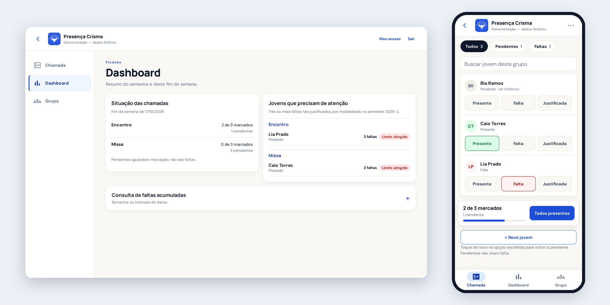
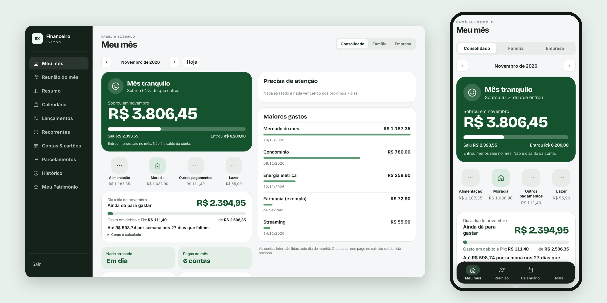
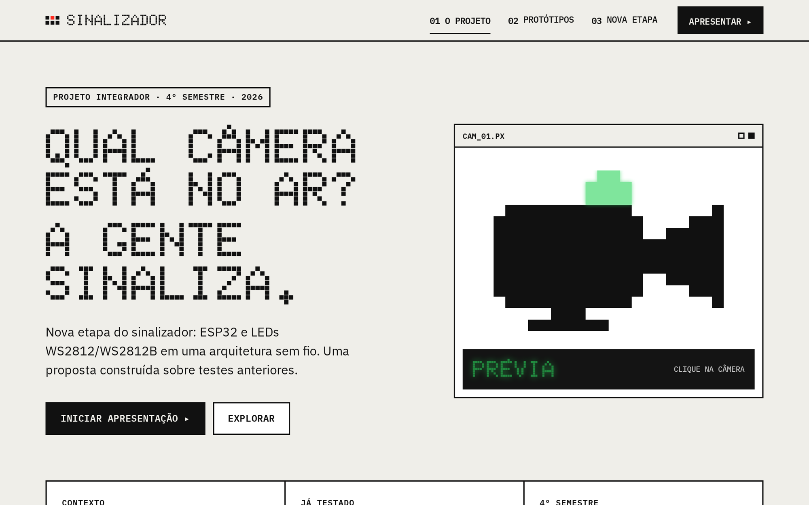

# Danilo Portilho

Estudante de **Engenharia da Computação no UNISAL** (conclusão prevista para dez/2028), em Campinas, SP. Trabalho com operação e tecnologia na ProAventura desde set/2026.

Meu foco é **IA aplicada e automação**: pegar um problema real (de uma empresa, da minha família, da minha comunidade), definir a solução e entregar algo que as pessoas usam de verdade.

**Como eu trabalho:** desenvolvo com agentes de IA (Claude Code, Codex). Eu levanto o problema com quem vai usar e defino escopo, regras e critérios de aceite. Os agentes fazem a maior parte da implementação, e eu reviso, testo e publico. Os quatro projetos abaixo estão em uso real.

## Projetos

### Catálogo B2B — ProAventura
**Problema:** a equipe comercial mandava PDF para cada revendedor que queria cotar um produto.
**Solução:** catálogo web com login para revendedores e equipe, filtros, carrinho de cotação e painel interno.
**Destaques:** estoque sincronizado com o ERP (Bling) via webhook; confirmação de cotação por WhatsApp (BotConversa), em piloto.
**Stack:** HTML/CSS/JS, Supabase (PostgreSQL, RLS, Edge Functions), Netlify.
**Status:** em uso piloto · código privado · [página pública do projeto](https://github.com/daniloptoledo/catalogo-proaventura)

### Sistema de Chamada da Crisma
**Problema:** a presença de cerca de 100 jovens em encontros e missas era controlada em planilha.
**Solução:** app para catequistas registrarem presença, com alerta automático a partir de 3 faltas não justificadas e importação do histórico em Excel (com prévia e sem duplicatas).
**Destaques:** permissões por perfil e privacidade como requisito central (dados de menores); bancos de teste e produção separados.
**Stack:** Cloudflare Pages, Cloudflare D1 (SQLite).
**Status:** em uso desde out/2026 · código privado

### Financeiro Familiar
**Problema:** organizar as finanças da casa sem depender de lançamento manual.
**Solução:** app com sincronização bancária diária (Open Finance), conciliação entre contas, detecção de transferências internas e duplicidades, recorrências e previsão dos próximos meses.
**Destaques:** auditoria de edições, nenhuma credencial bancária armazenada, testes com dados sintéticos e CI.
**Stack:** Next.js, TypeScript, Supabase/PostgreSQL, Vercel.
**Status:** em uso pela família · código privado

### Sinalizador de Câmeras de Estúdio
**Problema:** em gravações com várias câmeras, o apresentador não sabe para qual câmera olhar.
**Solução:** sinalização luminosa por câmera, lendo o estado da mesa de corte Blackmagic ATEM Mini Pro. Projeto acadêmico feito para o estúdio real da Comunidade Católica Pantokrator.
**Destaques:** integração ATEM → Python → Arduino validada; módulos LED RGB WS2812B; próxima etapa sem fio com ESP32 (projeto de iniciação científica para 2027).
**Stack:** Python, C/C++ (Arduino), ESP32, comunicação serial.
**Status:** protótipo funcional · [site do projeto](https://sinalizador-cameras-site.pages.dev) · [código](https://github.com/daniloptoledo/sinalizador-cameras-estudio)

### AP Consultório
App instalável (PWA) de agenda, pacientes, evolução e financeiro para um consultório de psicologia.
**Stack:** React, TypeScript, Supabase, Web Push. **Status:** em uso · código privado (dados de saúde)

## Conhecimentos

- **Uso no dia a dia:** Supabase/PostgreSQL, Git/GitHub, deploy (Vercel, Netlify, Cloudflare), agentes de IA para desenvolvimento
- **Contato em projetos, em consolidação:** Python, SQL, JavaScript/TypeScript, React, Next.js
- **Acadêmico:** C, C#, Java, Arduino

## Procurando

Estágio em **IA aplicada, dados, automação, QA ou sistemas**, para aprender e contribuir em problemas reais.
